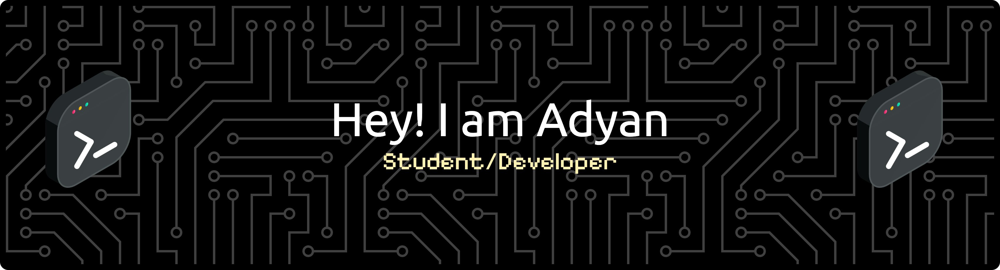

  

  

  <b>About me</b>

  I’m currently learning: <b>React & Next.js</b> 
  My goal: <b>Improve my programming skills and learn new technologies</b>

 

  <b>GitHub Stats</b>

   
   
  

 

  <b>Skills</b>

<b>Frontend</b>

  

 

<b>Backend</b>

  

 

<b>Databases</b>

  

 

<b>Testing & Tools</b>

  
  

 

<b>OS & Hardware</b>

  

 

  
  
  
   
  
  

 

  <b>Connect with me</b>

  
  
  

  

